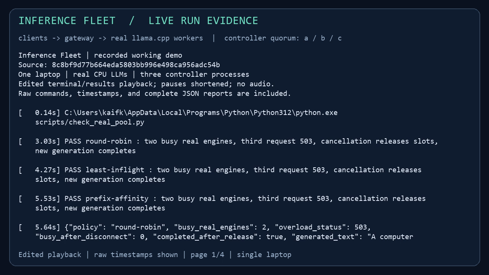
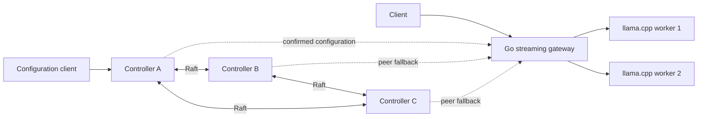

# Distributed LLM Serving

[](https://github.com/Kaif10/distributed-llm-serving/actions/workflows/ci.yml)

**A streaming LLM gateway with a custom Raft-replicated control plane.**

Route requests across model replicas, bound overload, drain workers, and recover controller
state after failures. Built in Go with Python experiment tooling; real inference runs through
llama.cpp and pinned SmolLM2 weights. Raft replicates configuration and successful request
history. Prompts, generated tokens, and model weights stay on the serving path.

[Architecture](docs/ARCHITECTURE.md) ? [Design decisions](docs/DECISIONS.md) ? [Evidence](docs/EVIDENCE.md) ? [Walkthroughs](docs/learning/README.md)

## Watch the system fail and recover

Two real model servers. Three controller processes. A gateway forwarding live generated
tokens while controllers lose their leader, lose quorum, and recover from a retained snapshot.



Actual Windows console capture, continuous and at real-time speed. Commands execute during
recording; the terminal shows real process IDs, arriving model tokens, HTTP responses, and
failure/recovery actions. [Full-resolution MP4](docs/demo/demo.mp4) ? [Recording details and raw output](docs/demo/README.md)

The recorded scenarios exercise:

- **Admission and cancellation:** occupy both real engines, reject the next request with
  HTTP 503, disconnect the clients, observe released slots, and generate again.
- **Replication and catch-up:** stop a follower, commit changes with a majority, retain the
  log prefix, then recover that follower through snapshot installation and suffix replay.
- **Controller failure:** kill the leader and confirm that the gateway switches to a new
  source; apply a drain and resume without putting consensus on the token path.
- **Quorum loss and recovery:** expire the gateway's configuration view, reject new work
  while an existing stream finishes, restore an installed checkpoint, and generate again.
- **Historical retries:** return an original successful result after restart even when the
  current configuration has advanced.

## Two paths, separate responsibilities



**Serving path:** bounded body uploads with independent deadlines before worker admission;
round-robin, least-inflight, or bounded prefix affinity; per-worker local
admission; health probes; draining; streaming responses; cancellation and deadlines.
Prefix affinity uses an explicit client hint and leaves KV-cache management to the engine.

**Control path:** versioned compare-and-swap updates, durable successful request IDs,
fixed-membership Raft elections and replication, current-term majority-confirmed reads,
application checkpoints, manual retention, and lagging-peer snapshot installation.

Controller polling happens outside generation requests. Gateways expose their applied
revision and reject new work after their last confirmed view expires. A committed drain
records desired state; it does not by itself prove every gateway has finished draining.

## Failure contracts and checks

| Event | Expected behavior | Reproducible check |
| --- | --- | --- |
| Every eligible worker is busy | Reject excess work; keep admission bounded | [Real two-worker pool](scripts/check_real_pool.py) |
| Client stalls while uploading | Hold an upload token, not worker capacity; expire the body read | [Upload and admission regressions](internal/gateway/upload_test.go) |
| Client disconnects mid-generation | Propagate cancellation and observe engine slot release | [Real inference](scripts/check_real_inference.py) |
| Controller leader dies | Elect with a surviving majority; gateway confirms a replacement source | [Real-model failover](scripts/check_controller_failover.py) |
| Controller majority disappears | Fresh reads/writes cannot complete; gateway expires its view | [Quorum reads](docs/learning/18-read-quorum.md) |
| Follower misses a removed prefix | Install a validated durable image, then replicate the suffix | [Three-peer retention](scripts/check_replicated_retention.py) |
| Storage publication has an uncertain outcome | Fence the owner; select and sync complete state on reopen | [Storage process-kill tests](internal/raft/retained_process_test.go) |

The evidence includes a clean-source single-controller run reaching absolute log index
**1103** through periodic retention, followed by two abrupt restarts preserving original
retry results. That workload has **two unique successful updates and 1100 logged retries**;
it is a correctness exercise, not a throughput benchmark. [Raw result](docs/results/controller-local-retention-346ac82.json)

Routing experiments separately examine prefix reuse, fixed-arrival goodput, mixed request
costs, and worker restart under load. Conditions, negative outcomes, and raw measurements
are in the [evidence ledger](docs/EVIDENCE.md). No GPU performance or algorithmic novelty
claim follows from the CPU results.

## Run real inference locally

The supplied setup targets Windows x64 with Python 3.11+ and Go 1.26+ on PATH. It downloads
checksum-verified engine/model assets into ignored `.tools/`; model weights are not committed.

```powershell
python scripts/setup_llama.py
powershell -ExecutionPolicy Bypass -File scripts/run_llama.ps1
```

In a second terminal, start the gateway:

```powershell
go run ./cmd/gateway -listen 127.0.0.1:18080 -backend http://127.0.0.1:18081 -request-timeout 60s
```

In a third terminal, request a real stream:

```powershell
curl.exe --no-buffer -H "Content-Type: application/json" --data-binary "@examples/real-stream.json" http://127.0.0.1:18080/v1/chat/completions
```

For the complete controller path, build the services and run the retained-mode scenario:

```powershell
go build -o bin/gateway.exe ./cmd/gateway
go build -o bin/raftpeer.exe ./cmd/raftpeer
python scripts/check_controller_failover.py --retention --live --output artifacts/controller-failover/local.json
```

That runner starts its own engine, gateway, and three peers, injects failures, checks the
outcomes, and cleans up its processes. See [real inference setup](docs/learning/03-real-inference.md)
and [peer snapshot recovery](docs/learning/27-peer-snapshot-recovery.md) for individual commands.
The Go services and native peer checks also run in Linux CI; the supplied model setup and
screen recorder are Windows-specific.

## Validate the implementation

```sh
go test ./...
go vet ./...
go build ./...
```

Linux CI also runs `go test -race ./...`, native-process replication/recovery checks,
and the three-peer retention scenario. Real-model checks run separately with pinned local
assets. Ordinary CI uses explicit synthetic fixtures and does not download model weights.

## Scope and limits

This is a local systems prototype with real model execution and real process/network/file
I/O. Validation runs on one laptop; independent-host, disk, and power failures remain
unvalidated. The custom consensus implementation adds maintenance and correctness costs;
[the design decisions](docs/DECISIONS.md) discuss established implementations as alternatives.

Retention is manual. The application checkpoint codec is bounded at 1024 successful request
IDs and an eight-MiB payload. New retained-mode commands reject fresh successes that would
exceed those bounds while preserving original retries; legacy command replay is unchanged.
[Review follow-up and compatibility](docs/learning/28-review-admission.md).
Admission counters are local to each gateway. Listeners use
trusted loopback HTTP without authentication or TLS. Dynamic membership, distributed model
execution, cross-request engine batching, and production deployment are outside this scope.

The evidence preserves an intermittent Windows connection reset during an earlier drain
probe and an earlier interrupted cache-experiment timeout. Successful later runs do not
establish fixes for those observations. External application demand remains unvalidated;
workload-driven scheduling and sharding are deferred.

## Explore the implementation

| Area | Entry points |
| --- | --- |
| Gateway, routing, cancellation | [Gateway code](internal/gateway) ? [Serving walkthroughs](docs/learning/README.md) |
| Consensus and persistence | [Raft core](internal/raft) ? [Peer runtime](internal/raftnet) |
| Ordered configuration and retries | [State machine](internal/control/machine.go) ? [Checkpoint codec](internal/control/checkpoint.go) |
| Tradeoffs and failure contracts | [Architecture](docs/ARCHITECTURE.md) ? [Decisions](docs/DECISIONS.md) |
| Experiments and limitations | [Evidence ledger](docs/EVIDENCE.md) ? [Recorded demo](docs/demo/README.md) |

Engine/model provenance and SHA-256 pins are recorded in [config/llama-cpu.json](config/llama-cpu.json).
