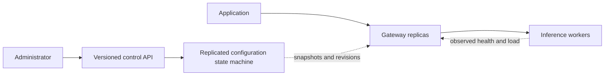

# Intended architecture

This describes the target. The current implementation is only the HTTP service foundation.

## Request path

Validate and bound the request, acquire admission capacity, select a compatible worker,
forward the stream, and release capacity on every completion or failure path. Generation
uses the gateway's local configuration view. Prompts and generated tokens never enter Raft.

Initially one gateway uses static configuration. Multiple gateways and replicated
configuration are separate milestones, so their coordination costs can be measured.

## State and guarantees

| State | Owner | Planned consistency |
| --- | --- | --- |
| Desired worker assignments and drain flags | Controller | Versioned CAS; linearizable after Raft integration |
| Routing configuration snapshot | Each gateway | May lag; bounded maximum age, revision exposed |
| Worker health and in-flight observations | Gateway/worker | Approximate; may be stale |
| Model KV cache | Inference engine | Local and evictable; never assumed durable |
| Active response stream | Gateway and worker | Ends on completion, cancellation, or failure; no transparent resume |

Administrative updates have request IDs for safe retries. That does not imply exactly-once
model execution. If a connection fails after dispatch, the gateway may not know whether
inference started. The initial policy is no automatic generation retries.

During loss of controller quorum, configuration writes stop. Gateways may use their last
accepted view only within its configured age, subject to worker health checks. When that
age expires, reject new work; existing streams may finish. The age bound is an availability
tradeoff, not evidence that an old view reflects a newly committed drain.

## Draining

A committed drain revision expresses desired state. A completed fleet drain additionally
requires gateway acknowledgement of that revision and no active work, or explicit handling
of unreachable gateways. Do not label a controller acknowledgement "drain complete".

## Boundaries

A gateway failure interrupts its streams. Another gateway can serve new requests. Replication
of configuration does not make an active stream fault tolerant. A worker crash loses local
cache and active inference. Same-host replicas do not protect against loss of the host or disk.

The foundation binds to loopback. Authenticated administrative access, client authentication,
TLS, and a deployment threat model are required before external exposure; they are future
deployment work, not implemented properties of the foundation.
