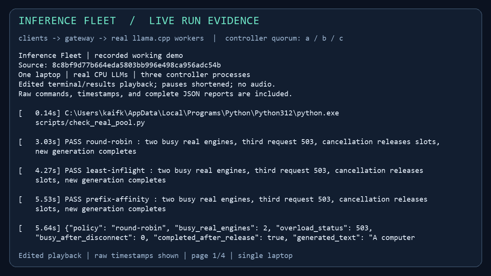

# Recorded working demo

[Watch the 32-second MP4](demo.mp4) · [Poster](poster.png) · [Raw capture](raw/) · [Attempt history](attempts.json)

[](demo.mp4)

Recorded from clean source `8c8bf9d77b664eda5803bb996e498ca956adc54b` on Windows,
using the pinned llama.cpp b12110 CPU engine and real SmolLM2-135M Q4_K_M generation.
The complete successful capture took 37.907 seconds. The exported video is 1280×720,
32 seconds, captioned, and silent. It is edited terminal/results playback from actual
commands and outputs, not an OS screen recording. Four pages display for eight seconds
each; pauses are shortened and selected result fields are shown. Pause to inspect text.
No outcomes or generated text are simulated. Raw timestamps and complete reports remain
in [transcript.jsonl](raw/transcript.jsonl), [session.json](raw/session.json), and the JSON
scenario reports. [Media metadata](media.json) records the hash, renderer, and successful
decode of every exported frame.

The demo shows:

1. Two real model servers under round-robin, least-inflight, and prefix-affinity routing:
   two active slots, overload 503, disconnect cancellation, then completed generation.
2. Three real controller processes: an offline follower installs retained boundary 6,
   catches up to revision 6, survives leader loss and full restart, and preserves the
   original revision-1 retry result. Wrong-group traffic cannot advance the term.
3. A real-model gateway switches controllers after leader loss, applies drain/resume,
   rejects new work after quorum-loss view expiry while an existing real stream finishes,
   restores an installed checkpoint, reconfirms the same revision, and generates again.

All processes run on one laptop. This establishes exercised mechanisms, not GPU
throughput, independent-host resilience, or production readiness. Retention is manual;
successful-request history remains bounded; TLS/authentication and dynamic membership
are outside this local demo. Workload-driven scheduling/sharding remain deferred.

## Failed capture retained

The first complete capture stopped at the drain rejection probe with Windows
`ConnectionResetError` / `WinError 10054`. No passing video was exported. Its complete
timestamped output, reports, and process logs are in [failed-attempt-1](failed-attempt-1/).
The second capture used identical source and binaries and passed. The cause of the first
reset is not established; a rerun is not a claimed fix. The earlier separate retained-mode
real-model check also passed. This is a disclosed intermittent observation, not a hidden
success-only benchmark.

## Reproduce

Install the pinned local CPU assets according to the repository's real-inference setup,
then build both services from a clean committed checkout:

```powershell
go build -o bin/raftpeer.exe ./cmd/raftpeer
go build -o bin/gateway.exe ./cmd/gateway
python scripts/record_demo.py --output artifacts/demo/new-run
```

Rendering uses existing Python `Pillow` and `imageio-ffmpeg`; they are not Go service
dependencies. The default Windows font is Consolas. `--render-only` re-exports an existing
successful capture without running scenarios again. Failed sessions are rejected by the
renderer. Capture refuses a dirty tree or an existing session path. The model scenarios
use only their own subprocesses and perform no downloads or paid provisioning.
